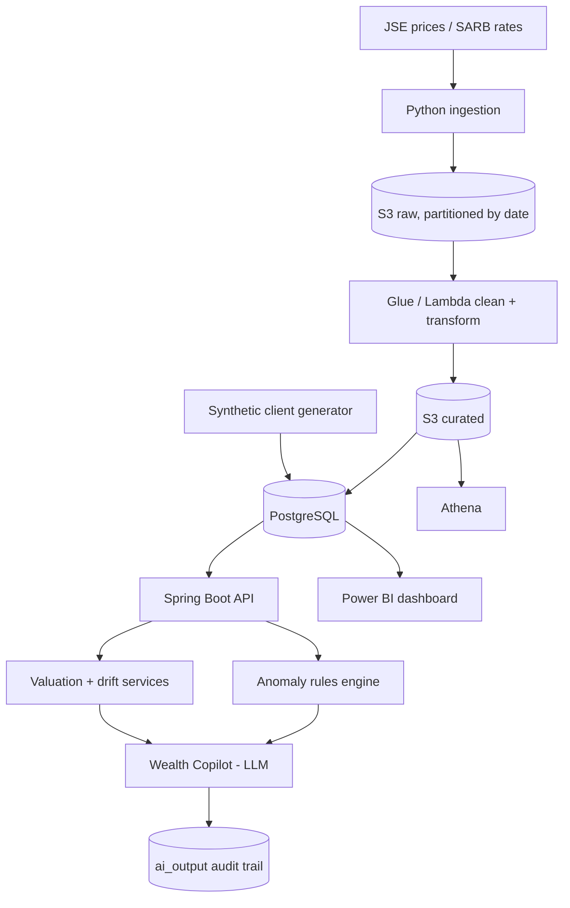

# Architecture

## Principles

1. **Transactions are the source of truth.** Holdings and values are derived.
2. **Deterministic first, AI second.** Java calculates; the LLM explains.
3. **Every AI output is auditable.** Inputs, prompt version and model are stored with the text.
4. **Synthetic data only.** No real client information.
